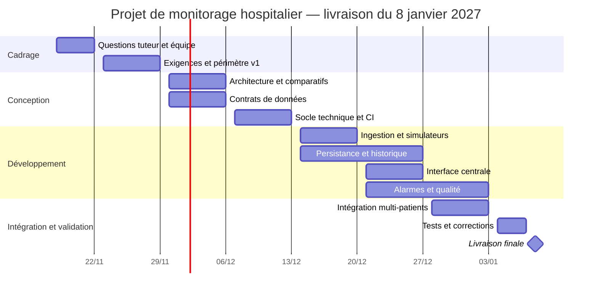

# 03 — Planning Gantt générique

**Version :** 1.0 — **Date de préparation :** 18 novembre 2026  
**Début de planification :** 18 novembre 2026  
**Échéance :** vendredi 8 janvier 2027  
**Nature :** maquette de macro-planning, à ajuster après la réponse du tuteur et les disponibilités des quatre membres.

## 1. Hypothèses

- Le projet est un projet logiciel complet à livrer, pas une simple preuve de concept.
- La nature générale du système est déjà connue : monitorage hospitalier, moniteurs de chevet et centrale(s).
- Les services exacts, fonctionnalités, technologies et critères de notation restent à valider.
- Les activités se chevauchent : cadrage, conception, développement, intégration et tests ne doivent pas être strictement séquentiels.
- Les périodes du 21 décembre au 4 janvier comportent Noël et le Jour de l'An ; la disponibilité de l'équipe doit être confirmée.
- Le 8 janvier est réservé à la livraison et à la démonstration, pas à un développement important.

## 2. Gantt macro

`█` = période principale de travail ; `░` = activité de soutien / chevauchement.

| Chantier / période | 18–22 nov. | 23–29 nov. | 30 nov.–6 déc. | 7–13 déc. | 14–20 déc. | 21–27 déc. | 28 déc.–3 janv. | 4–8 janv. |
|---|:---:|:---:|:---:|:---:|:---:|:---:|:---:|:---:|
| Questions tuteur et organisation équipe | █ | ░ | | | | | | |
| Recherche médicale ciblée et clôture des inconnues | █ | █ | ░ | | | | | |
| Exigences fonctionnelles et critères d'acceptation | ░ | █ | █ | ░ | | | | |
| Comparaison et décision d'architecture | | ░ | █ | █ | | | | |
| Contrats de données et modèle métier | | █ | █ | ░ | ░ | | | |
| Infrastructure, dépôt, CI, environnement | | ░ | █ | █ | ░ | | | |
| Backend et communication des moniteurs | | | ░ | █ | █ | ░ | ░ | |
| Simulation des signaux / données / appareils | | ░ | ░ | █ | █ | █ | ░ | |
| Base de données et historique | | | ░ | █ | █ | ░ | ░ | |
| Interface centrale multi-patients | | | ░ | ░ | █ | █ | ░ | |
| Alarmes, qualité et workflow soignant | | ░ | ░ | ░ | █ | █ | █ | ░ |
| Intégration et tests de bout en bout | | | ░ | ░ | █ | █ | █ | █ |
| Robustesse, sécurité et performance | | | | ░ | ░ | ░ | █ | █ |
| Documentation, installation et démonstration | | | | | ░ | ░ | █ | █ |

## 2 bis. Diagramme Gantt Mermaid modifiable

Le diagramme ci-dessous est une représentation de départ. Les dates et durées sont volontairement génériques : elles devront être recalées en fonction des réponses du tuteur, des disponibilités réelles et des résultats des premiers essais.

## 3. Jalons et livrables

| Jalon | Date cible | Résultat attendu | Condition de passage |
|---|---|---|---|
| M0 — Lancement | 22 nov. 2026 | Réponses tuteur initiales, responsabilités et disponibilités | Périmètre et contraintes bloquantes identifiés |
| M1 — Exigences version 1 | 29 nov. 2026 | Services, utilisateurs, fonctionnalités, données et scénarios priorisés | Fonctions obligatoires distinguées des extensions |
| M2 — Architecture version 1 | 6 déc. 2026 | Comparatifs terminés, choix techniques documentés, contrats gelés en v1 | Un test d'intégration minimal est planifié |
| M3 — Socle opérationnel | 13 déc. 2026 | Dépôt, CI, environnement, schéma de données et serveur démarrent | Installation reproductible et tests de base |
| M4 — Premier flux complet | 20 déc. 2026 | Un moniteur virtuel envoie des données reçues, persistées et affichées | Démonstration de bout en bout, avec horodatage et provenance |
| M5 — Fonctions intégrées | 27 déc. 2026 | Multi-patients, historique, alarmes et états techniques intégrés selon périmètre | Scénario principal rejouable |
| M6 — Gel fonctionnel | 3 janv. 2027 | Fonctionnalités prioritaires intégrées, plus de changement architectural majeur | Aucun défaut bloquant connu |
| M7 — Version candidate | 7 janv. 2027 | Tests, documentation, installation et démonstration vérifiés | Procédure de livraison répétée |
| M8 — Livraison | **8 janv. 2027** | Rendu final et démonstration | Dépôt et livrables conformes à la consigne |

## 4. Dépendances importantes

1. Le choix des services détermine les profils d'appareils, paramètres, utilisateurs et workflows.
2. Les fonctionnalités déterminent les contrats de données et le modèle métier.
3. Les contrats de données déterminent les API, événements et schéma de persistance.
4. Le choix de protocole doit être testé sur les cadences réelles retenues pour les courbes.
5. Le workflow d'alarme détermine les événements, les rôles, l'interface et l'audit.
6. L'interface multi-lits dépend de l'association correcte patient / séjour / lit / appareil / session.
7. La charge de waveform détermine les stratégies de stockage et de rendu graphique.
8. Les tests de panne doivent être prévus dès la conception, pas ajoutés après coup.

## 5. Répartition indicative sur quatre chantiers

| Chantier | Travail dominant | Collaborations indispensables |
|---|---|---|
| Médical / données / simulation | Semaines 1 à 5 | Contrat d'observation, qualité, profils et validation des scénarios |
| Backend / réseau | Semaines 2 à 7 | Contrats, sécurité, persistance, événements et charge |
| Base de données / sécurité | Semaines 2 à 7 | Modèle métier, audits, sauvegarde et contrôles d'accès |
| Interface centrale | Semaines 3 à 7 | API, affichage des courbes, états d'alarme et ergonomie |

Les responsabilités nominatives sont à remplir dans le [questionnaire équipe](02-questionnaire-equipe.md).

## 6. Chemin critique

`Validation du périmètre → Contrats de données → Socle serveur/BDD → Premier flux moniteur → Intégration interface → Workflow alarmes → Tests de bout en bout → Version candidate → Livraison`

Les retards sur les contrats, l'identité patient/appareil, l'ingestion ou l'intégration ont le plus fort impact sur la livraison.

## 7. Règles de pilotage du planning

- Mettre à jour les dates, responsables, charges et statuts chaque semaine.
- Ajouter un responsable et un résultat vérifiable à chaque tâche.
- Prévoir un jalon de démonstration chaque semaine.
- À chaque retard, décider explicitement si l'on réduit le périmètre, change de stratégie ou ajoute de la capacité.
- Ne pas repousser tous les tests à la dernière semaine.
- Geler les nouvelles fonctionnalités au plus tard le 3 janvier, sauf correction bloquante.
- Conserver les 7 et 8 janvier pour la validation finale, la correction limitée et la livraison.
